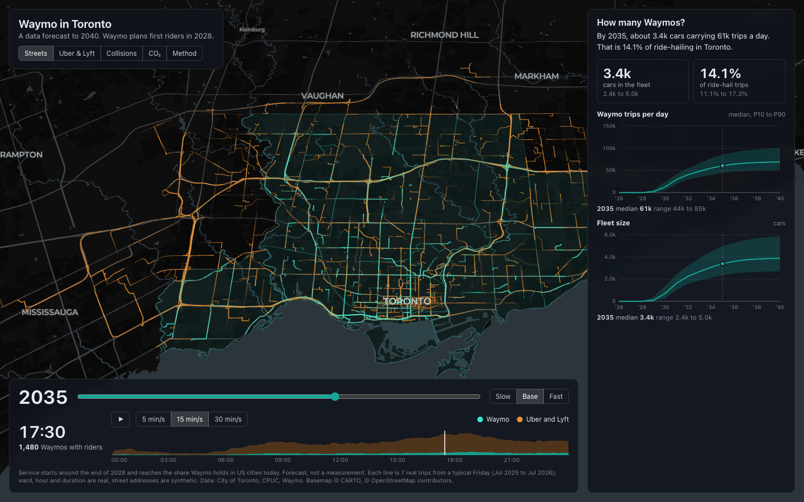

# Waymo in Toronto

An interactive forecast of what Waymo robotaxis would do to Toronto from 2026 to 2040: cars on the road, Uber and Lyft displacement, collisions and CO₂. Built with Vite, React, deck.gl and MapLibre, on the same stack as `bike-share-visualizer`.



Waymo announced Toronto on October 16, 2026 and is targeting first riders in 2028. Everything after today is a forecast, not a measurement. See [docs/research.md](docs/research.md) for the findings and sources.

## Run

```sh
npm install
npm run dev        # http://localhost:5173
npm run build      # static site in dist/
```

`public/data/` is already built, so the site runs without the Python steps.

URL options: `?year=2035`, `?scenario=slow|base|fast`, `?view=streets|drivers|safety|climate`, `?t=17:30`, `?paused`, `?method`. Press Space to play or pause.

The animated map needs a real GPU. It ran at about 45 fps on an Apple M4, and software rendering freezes it.

## Rebuild the data

```sh
uv venv --python 3.12 .venv && uv pip install --python .venv/bin/python -r requirements.txt
```

Download these into `data/raw/` first. The sources are listed in [docs/research.md](docs/research.md).

| Folder | Files |
| --- | --- |
| `ptc/` | `trips_2018.zip` to `trips_2026.zip`, `summary_stats.csv` |
| `cpuc/` | Waymo deployment zips for 2025 Q1 to 2026 Q2, plus the avrideshare page saved as `avrideshare_waymo.html` |
| `collisions/` | `traffic_collisions.csv`, `ksi.csv` |
| `geo/` | `neighbourhoods.geojson`, `wards.geojson`, `nbhd_2021.xlsx` |
| `waymo/` | Safety hub `csv3.csv` |
| `weather_yyz.json` | Open-Meteo hourly archive, 2018 to 2026 |

Then run each script from the project root with `.venv/bin/python -I pipeline/<script>`:

| Order | Script | What it does |
| --- | --- | --- |
| 1 | `00_fetch_osm.py` | Downloads the street network |
| 2 | `01_prepare_trips.py` | Aggregates nine years of ride-hail trips |
| 3 | `02_waymo_series.py` | Builds Waymo's monthly California series |
| 4 | `03_ramp_and_market.py` | Fits the Waymo ramp and Toronto market growth, with backtests |
| 5 | `03b_demand_weather.py` | Trains the hourly demand and weather model |
| 6 | `04_geo_features.py` | Builds neighbourhood features |
| 7 | `05_collision_model.py` | Trains the collision model |
| 8 | `06_routes.py` | Routes a sampled Friday on the street network |
| 9 | `08_export_geo.py` | Writes the map geometry |
| 10 | `07_simulate.py` | Runs the Monte Carlo and writes `public/data/model.json` |

`08_export_geo.py` runs before `07_simulate.py` because the simulation reads `public/data/wards.geojson`.

## Credit

Credit the data wherever you post this: City of Toronto Open Data, Toronto Police Service, California Public Utilities Commission, Waymo, © OpenStreetMap contributors, © CARTO.
